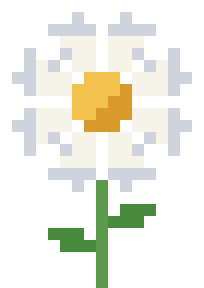

  

<h1 align="center">Matricaria</h1>

  Открытая пиксельная ролевая песочница, в которой персонажами управляет ИИ. 
  Работает локально, без подписок и облака. Внешние API можно подключить по желанию.

---

> **Статус:** ранняя стадия, идёт проектирование. Код ещё не написан.

## Что это

- **Пиксельный мир сверху.** Генерируется под сеттинг: фэнтези или современность.
- **Персонажи с ИИ.** Если заговорить с персонажем, открывается сцена диалога: до 5 персонажей в полный рост, в аниме- или пиксельном стиле.
- **Мир живёт сам.** У NPC есть распорядок, цели и отношения. Время можно перемотать вперёд или откатить назад.
- **ИИ не переписывает историю.** Правду о мире хранит движок, а ИИ только описывает её (подробнее в [docs/07-validator.md](docs/07-validator.md)).
- **Свой персонаж без программирования.** Встроенный редактор из слоёв и генерация портрета.
- **Всё открыто.** Godot, Python, llama.cpp, stable-diffusion.cpp, SQLite.

## Документация

Начните с [docs/README.md](docs/README.md).

## Лицензия

Код распространяется под [GPL-3.0](LICENSE). Графика LPC распространяется под CC-BY-SA / GPL, авторы перечислены в [CREDITS.md](CREDITS.md).
Проект некоммерческий: автор его не продаёт.
